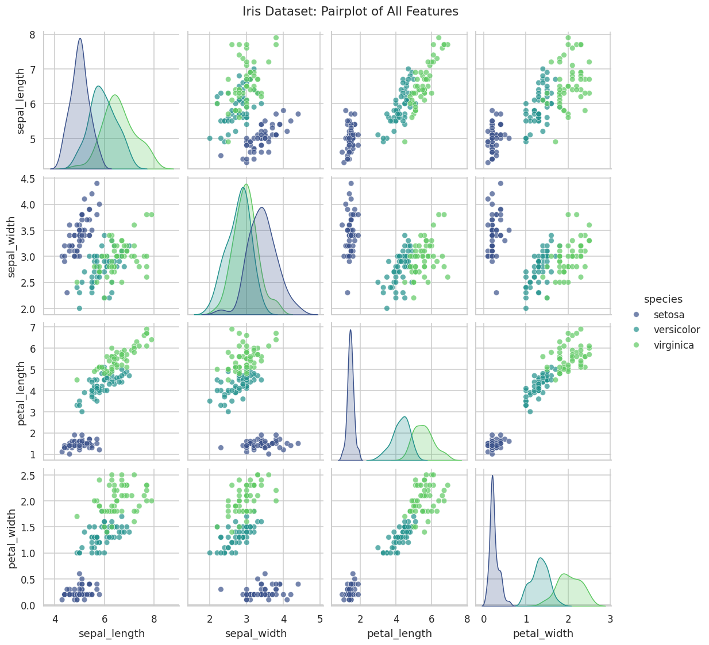
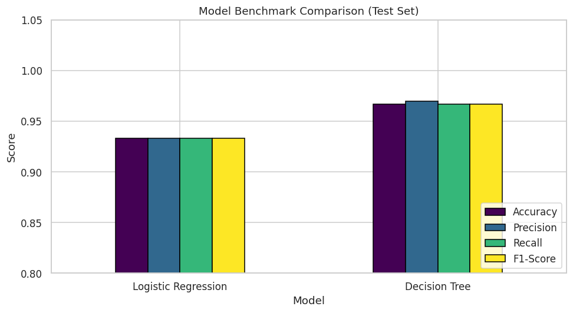
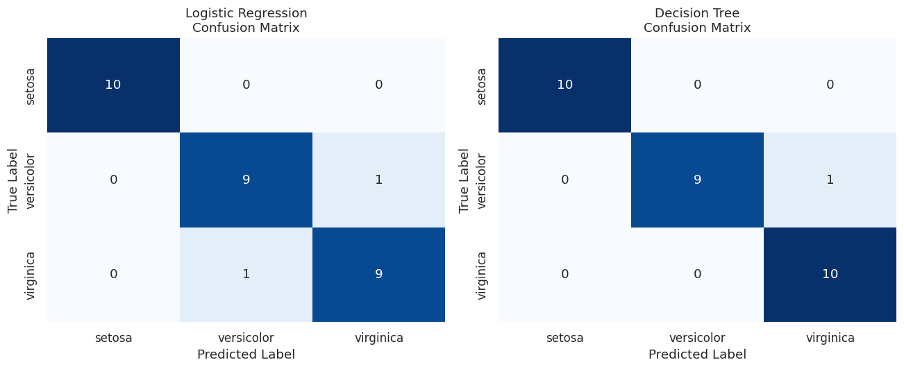
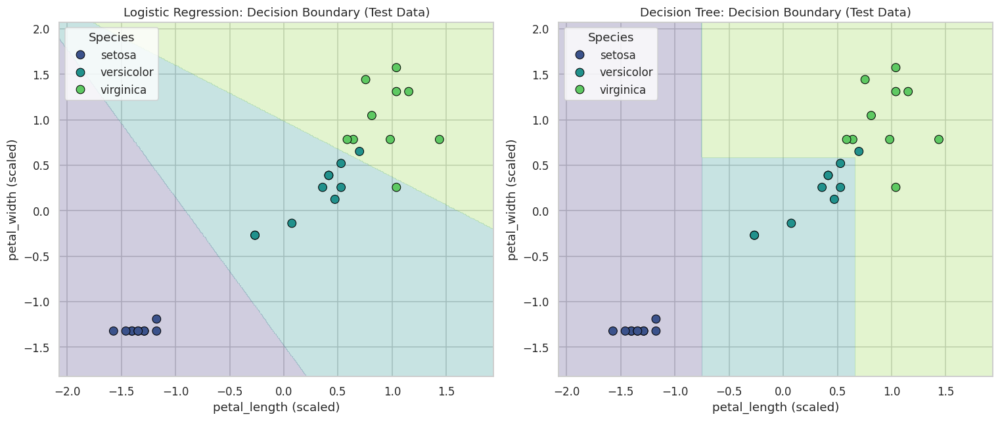
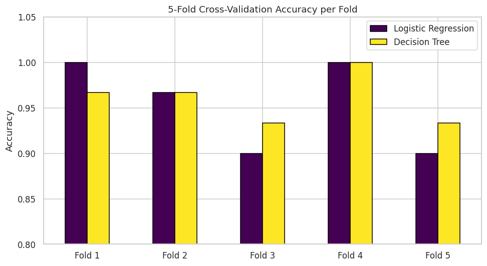

# Multi-Class Benchmark Classification Pipeline (Iris)

Benchmarks **Logistic Regression** against a **Decision Tree** on the Iris dataset, using an 80/20 stratified split, `StandardScaler`, and 5-fold cross-validation.

**Stack:** Python, Pandas, NumPy, Scikit-Learn, Seaborn, Matplotlib

## Results

| Model | Hold-out Accuracy (n=30) | Hold-out F1 (macro) | CV Accuracy (5-fold) |
|-------|-------------------------:|--------------------:|---------------------:|
| Logistic Regression | 0.9333 | 0.9333 | 0.9533 ± 0.0452 |
| Decision Tree (`max_depth=3`) | 0.9667 | 0.9666 | 0.9600 ± 0.0249 |

The hold-out gap equals a single test sample. Cross-validation shows the two models perform comparably, with the Decision Tree slightly more stable across folds.

## Visualizations

### Exploratory pairplot


### Benchmark comparison (test set)


### Confusion matrices


### Decision boundaries (`petal_length` vs. `petal_width`)


### 5-fold cross-validation


## Key Findings

- **Setosa is linearly separable.** Both models classify it perfectly. All errors occur between versicolor and virginica.
- **Petal features dominate.** `petal_length` and `petal_width` alone reproduce the full four-feature accuracy.
- **Different decision geometry.** Logistic Regression produces linear boundaries; the Decision Tree produces axis-aligned regions.

## Limitations

- Small dataset: single-split metrics are noisy (one test sample = 3.3 percentage points).
- `max_depth` was fixed, not tuned.
- The dataset contains one duplicated row, kept as in the standard benchmark version.

## How to Run

1. Open `iris_classification_benchmark.ipynb` in Google Colab.
2. Upload `iris.csv` to the session (`/content/iris.csv`).
3. Run all cells from top to bottom.

## Repository Structure

```
.
├── iris_classification_benchmark.ipynb
├── iris.csv
├── images/
└── README.md
```
